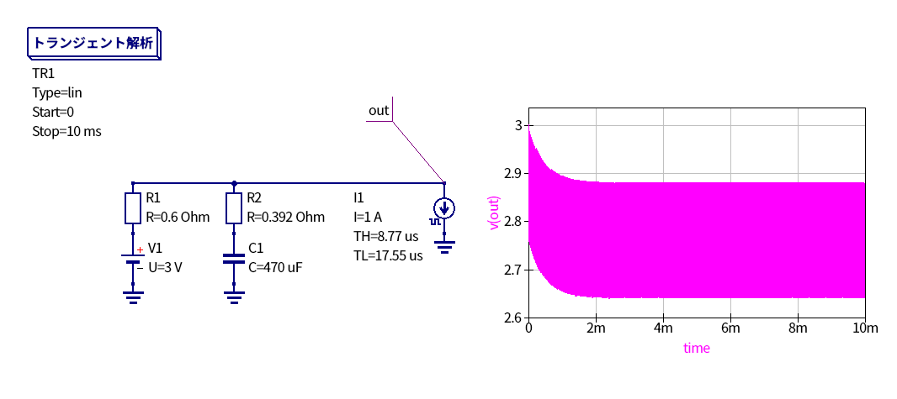

とりあえずQucs-Sでシミュレーション回しましたが多分大丈夫です．

電池のESRはアルカリ乾電池単3形 $R = 0.6 \mathrm{\Omega}$ で見積もりました．
コンデンサのESRはデータシートより $120 \mathrm{Hz}$ 時の損失角の正接が $\tan\delta = 0.2$，高周波域でのリプル電流補正係数が $k \approx 1.20$ なので

$$
\mathrm{ESR}_{120 \mathrm{Hz}} = \frac{0.2}{2 \pi \times 120 \times 470 \times 10^{-6}} \approx 0.564 \mathrm{\Omega}
$$

$$
\mathrm{ESR}_{38 \mathrm{kHz}} \approx \frac{\mathrm{ESR}_{120 \mathrm{Hz}}}{1.20^2} \approx 0.392 \mathrm{\Omega}
$$

です．
とりあえずバースト時を仮定して $\mathrm{Duty} = 33\%$ ， $f = 38 \mathrm{kHz}$ ， $I_{\mathrm{load}} = 1 \mathrm{A}$ のときの挙動を確認しています．
電圧降下はおおよそ $0.36 \mathrm{V}$ 程度でした．
